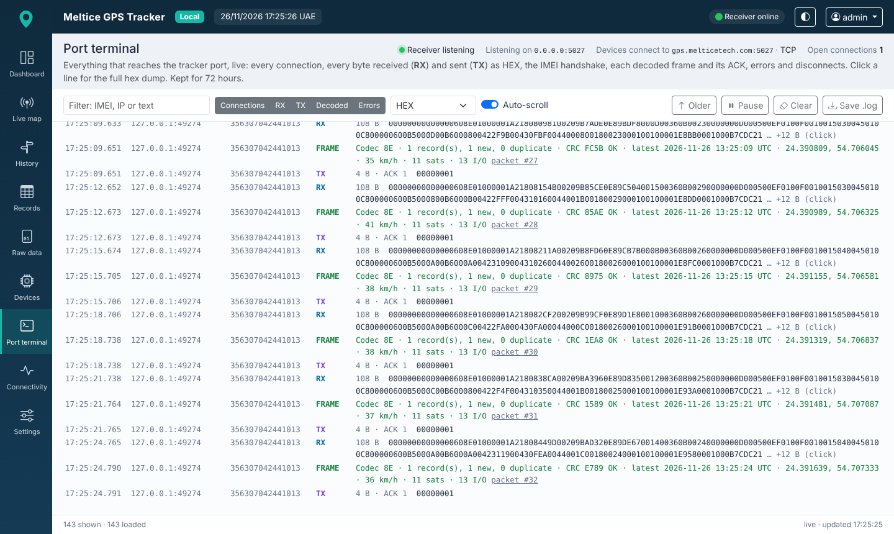
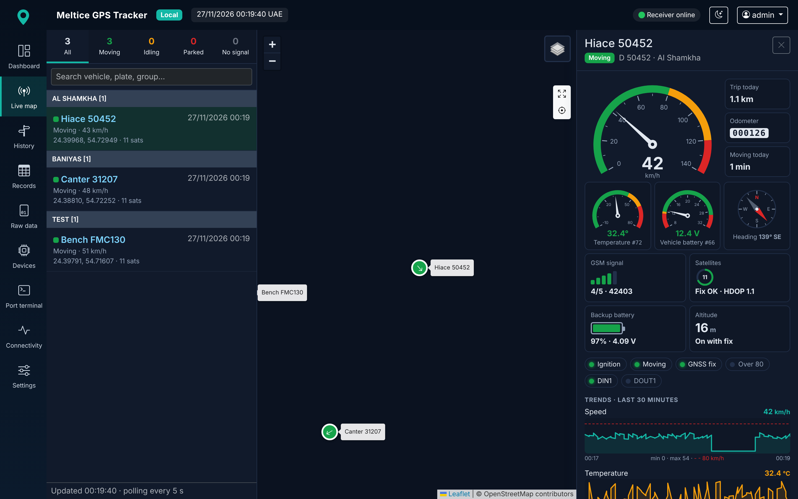
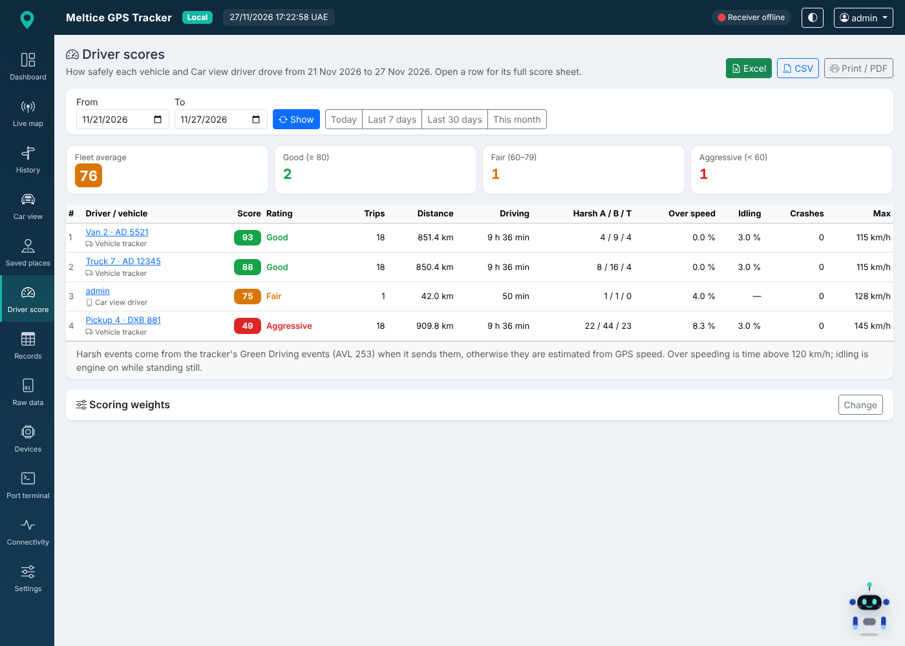

# Meltice GPS Tracker

Receives Teltonika **FMC130** telemetry over cellular TCP (Codec 8 / Codec 8 Extended), shows **every byte that
arrives on the tracker port in a live terminal**, keeps every raw packet, decodes GPS and I/O values into
**Microsoft SQL Server**, and serves the data through a web UI (light and dark theme) and a **REST API**.
Built to the *Meltice Fleet Phase 1 Scope* and the *FMC130 Connectivity Runbook*; the current focus is
connectivity testing and raw data on the Hostinger VPS.

```
FMC130 ──cellular──▶ TCP receiver :5027 ──▶ CRC + codec validation ──▶ raw packet + decoded records ──▶ SQL Server
                     (asyncio, separate          (one DB transaction, ACK only after commit)              │
                      process)  └── every connection / RX / TX byte / decoded frame / ACK ──▶ port events ─┤
Browser (login) ◀── Django web: Port terminal, Dashboard, Live map, Raw data, Connectivity ◀──────────────┤
Scripts / other systems ◀── REST API /api/v1/ (token or session auth, Swagger docs at /api/docs/) ◀─────┘
```



## What is in the box

| Area | Where |
|---|---|
| **Port terminal**: live view of everything reaching port 5027 — connections, every RX/TX byte as HEX, IMEI handshake, decoded frame summary, ACKs, errors, non-Teltonika traffic (scanners, browsers), disconnects. Filter, pause, hex dump, scroll back, save as .log | web **Port terminal**, `manage.py port_monitor` (SSH) |
| **REST API** v1: auth token, devices (CRUD), history, records + I/O, raw packets + re-decode, connections, port events (live tail), receiver status, connectivity tests | `tracking/api.py`, `/api/docs/`, `docs/API.md` |
| **Sign-in**: username + password, lockout after 5 failures, change password, roles (admin / staff / raw-data viewer / viewer) | `/login/`, user menu, `/admin/` |
| **Light / dark theme** (or follow the system), remembered per browser | theme button in the top bar |
| **SQL Server** database (2019/2022, Express is enough): least-privilege app login, setup + backup commands | `manage.py mssql_setup`, `manage.py mssql_backup` |
| Codec 8 / 8E parser, CRC-16/IBM, framing, encoder | `tracking/codec.py` |
| Async TCP receiver (IMEI allow-list, 0x01/0x00 handshake, fragmented + coalesced frames, timeouts, connection & rate limits, heartbeat) | `tracking/receiver.py` |
| Ingest: raw + records in one transaction, ACK after commit, idempotent replay, late-arrival flag, newest-fix-wins | `tracking/ingest.py` |
| FMC130 AVL I/O dictionary (versioned, unknown IDs kept) | `tracking/io_dictionary.py` |
| Screens: Dashboard, Live map, History, Records, I/O inspector, Raw data, Port terminal, Devices, Connectivity, Settings | `tracking/templates/` |
| Device simulator (multi-vehicle, Codec 8/8E, no-fix injection) | `manage.py simulate_device` |
| Connectivity / acceptance suite (13 protocol checks) | `manage.py conntest`, web **Connectivity → Run test**, `tools/fmc_probe.py` |
| Automated tests (37, run against SQL Server) | `tracking/tests/` |
| Local hosting with Docker (SQL Server 2022 + web + receiver) | `docker-compose.yml`, `Dockerfile` |
| Hostinger VPS hosting (SQL Server in Docker or external, systemd + Nginx) | `deploy/hostinger/`, `docs/HOSTINGER_DEPLOYMENT.md` |
| Physical FMC130 bench test guide | `docs/DEVICE_BENCH_TEST.md` |

---

## Option A — Local hosting

### A1. Docker (recommended, any OS with Docker Desktop) — includes SQL Server 2022

```bash
cp .env.example .env            # set FLEET_ADMIN_PASSWORD, MSSQL_SA_PASSWORD, FLEET_DB_PASSWORD, FLEET_SECRET_KEY
docker compose up -d --build    # first start pulls SQL Server and creates the database (1-2 minutes)
docker compose --profile sim up -d simulator     # optional: 3 simulated vehicles driving in Abu Dhabi
```

* Web UI: <http://127.0.0.1:8000> (login `admin` / the password from `.env`) → **Port terminal**
* Tracker TCP port: `5027` on all interfaces of your PC
* SQL Server: `127.0.0.1,1433` from this PC only (SSMS / Azure Data Studio; app login `fleet_app`)
* Terminal in your shell: `docker compose exec web python manage.py port_monitor`
* Logs: `docker compose logs -f receiver`
* Stop: `docker compose --profile sim down` (data stays in the volumes; add `-v` to wipe it)

SQL Server passwords must be 8+ characters with upper case, lower case, a digit and a symbol.

### A2. Plain Python (Windows / macOS / Linux, Python 3.10+) with your own SQL Server

Install the **Microsoft ODBC Driver 18 for SQL Server** first (Windows: Microsoft download page;
Ubuntu: see `deploy/hostinger/install.sh`; macOS: `brew install msodbcsql18`). Any SQL Server 2019/2022
works, including Express or Developer edition on your PC.

```powershell
python -m venv .venv
.venv\Scripts\activate            # macOS/Linux: source .venv/bin/activate
pip install -r requirements.txt
copy .env.example .env            # macOS/Linux: cp; set FLEET_DB_HOST / FLEET_DB_PASSWORD / FLEET_ADMIN_PASSWORD
$env:FLEET_DB_ADMIN_PASSWORD="<sa password>"; python manage.py mssql_setup   # creates database + fleet_app login
python manage.py migrate
python manage.py createcachetable
python manage.py ensure_admin
python manage.py seed_demo --i-want-demo-data   # optional, local trials only: fake vehicles + 2 h of history
```

Remove demo/test vehicles again (keeps the Jeep Wrangler; dry run first, then `--yes`):
`python manage.py clean_demo_data` then `python manage.py clean_demo_data --yes`.

No SQL Server at hand? `FLEET_DB_ENGINE=sqlite` in `.env` runs everything on a single file for a quick trial.

Then run the two processes in **separate terminals** (they are deliberately independent):

```powershell
python manage.py run_receiver --host 0.0.0.0 --port 5027
python manage.py runserver 127.0.0.1:8000
```

On Windows, `tools\start_local.ps1` opens both for you. Check the listener with
`Get-NetTCPConnection -LocalPort 5027 -State Listen` and `Test-NetConnection -ComputerName 127.0.0.1 -Port 5027`.

### Test connectivity locally

```bash
python manage.py conntest                       # 13 protocol acceptance checks against 127.0.0.1:5027
python manage.py simulate_device --interval 5   # one simulated FMC130 (Ctrl+C to stop)
python manage.py simulate_device --imei 356307042441021,356307042441054 --codec 8 --no-fix-every 10
python manage.py test tracking                  # unit + end-to-end tests (creates a temporary SQL Server test database)
```

Or open **Connectivity → Run test** in the web UI. To connect the real FMC130 to your PC you need a
public TCP path (router port-forward or raw-TCP tunnel) — see `docs/DEVICE_BENCH_TEST.md`.

---

## Option B — Hostinger hosting

Requires a **Hostinger VPS** (KVM 1 or larger — SQL Server needs 2 GB RAM; Ubuntu 22.04/24.04). Shared / Cloud web hosting cannot run a raw
TCP listener on port 5027, so it cannot receive tracker data.

```bash
# on the VPS (git clone https://github.com/connectbishar-byte/gps-tracker.git meltice-gps-tracker && cd meltice-gps-tracker)
sudo bash deploy/hostinger/install.sh      # SQL Server 2022 Express in Docker on 127.0.0.1:1433 + app + Nginx
# existing SQL Server instead:  sudo DB_MODE=external DB_HOST=... DB_NAME=... DB_USER=... DB_PASSWORD=... bash deploy/hostinger/install.sh
sudo certbot --nginx -d fleet.melticetech.com
sudo ufw allow 5027/tcp      # only if UFW is active — and open 5027 in hPanel's VPS firewall
```

Result: web at `https://fleet.melticetech.com` (Nginx → gunicorn `127.0.0.1:9040`), tracker endpoint
`gps.melticetech.com:5027`, services `gunicorn-fleet` and `fleet-receiver`. Full walkthrough including
DNS, SQL Server, Docker alternative, verification and rollback: **`docs/HOSTINGER_DEPLOYMENT.md`**.

Prove the VPS is reachable from the internet (run on your PC, not on the VPS):

```bash
python tools/fmc_probe.py gps.melticetech.com 5027
```

---

---

## Vehicle panel — every parameter, graphically

Click a vehicle on the **Live map** (or open its **Device** page) to see:

- a **speedometer**, **temperature** (AVL #72, needs a Dallas probe) and **vehicle battery** (#66) dials, and a **heading compass**
- tiles for **GSM signal** and operator, **satellites** and HDOP, **backup battery** (#113 / #67) and **altitude**
- status lights: ignition, movement, GNSS fix, over 80 km/h, DIN/DOUT, jamming, battery unplugged, towing (those the tracker sends)
- **trip today**, **odometer** and **moving time today**
- **30-minute trends** for speed, temperature and battery voltage
- **All parameters**, grouped (position, inputs and outputs, power, sensors, distance, network, events). Click any one to
  chart its history over 1 hour to 60 days, with min / average / max and a hover read-out.



The same data is in the REST API: `GET /api/v1/devices/{id}/telemetry/` and
`GET /api/v1/devices/{id}/parameters/{avl_id or speed|altitude|satellites|angle}/?hours=24`.

### How parameters are stored (SQL Server)

| Table | One row per | Holds |
|---|---|---|
| `tracking_avlrecord` | AVL record | time, latitude, longitude, altitude, heading, satellites, speed, priority, event id |
| `tracking_iovalue` | parameter per record | vehicle, time, AVL id, name, scaled value, display text, unit, raw HEX |
| `tracking_rawpacket` | TCP frame | the exact bytes received, CRC, ACK |

`tracking_iovalue` is indexed by (vehicle, AVL id, time), so any parameter can be charted or queried directly, e.g.
`SELECT timestamp_utc, value FROM tracking_iovalue WHERE device_id = 3 AND avl_id = 66 ORDER BY timestamp_utc`.

### Data retention per vehicle

Each vehicle has **Data retention (days)** on its Device page (default 60, set by `FLEET_DEFAULT_RETENTION_DAYS` for
new vehicles; also in the API as `retention_days`). A daily purge deletes that vehicle's records, parameter values,
raw packets and closed connections older than its retention, in small batches so the receiver keeps writing.

- Hostinger (native): `fleet-purge.timer` runs `manage.py purge_data` every day at 03:15 server time.
  Check it with `systemctl list-timers fleet-purge.timer` and `journalctl -u fleet-purge`.
- Docker: the `maintenance` service runs the purge every 24 hours.
- By hand: `python manage.py purge_data --dry-run` shows what would be deleted; drop `--dry-run` to delete.

Settings shows the default and when the last purge ran.

## Port terminal — see everything arriving on the port

Web: **Port terminal** in the left menu (staff and `raw_data` users). Each line is one event:

| Label | Meaning |
|---|---|
| `CONN` / `CLOSE` | TCP connection opened / closed, with reason, duration and frame count |
| `RX` | bytes received, exactly as they arrived (HEX, optional ASCII) — handshake, frames, or anything else |
| `IMEI` | handshake result: accepted, or rejected because the IMEI is not registered / disabled |
| `TX` | bytes the server sent: `01` / `00` handshake reply, 4-byte ACK |
| `FRAME` | decoded summary: codec, record count, new/duplicate, CRC, latest position, speed, satellites, I/O count; links to the stored packet |
| `ERROR` | bad CRC, framing error, non-Teltonika data (e.g. `GET / HTTP/1.1` from a scanner), database failure |
| `REFUSED` | connection limit or per-IP rate limit hit |

Filter by IMEI, IP or any text (including HEX), switch event types on/off, pause, load older events,
click a line for a full hex dump, and **Save .log**. Events are kept `FLEET_PORT_LOG_RETENTION_HOURS` (72 h).

Over SSH on the VPS:

```bash
sudo -u fleet bash -c 'set -a; . /etc/meltice-gps-tracker/fleet.env; cd /srv/meltice-gps-tracker/app; \
  /srv/meltice-gps-tracker/venv/bin/python manage.py port_monitor'          # follow live, Ctrl+C to stop
#   --imei 356307042441013   --remote 100.64.   --kind rx,tx   --spaced   --no-follow -n 500 > capture.log
```

**Commissioning a tracker whose IMEI you don't know yet:** set `FLEET_AUTO_REGISTER_UNKNOWN=true`, restart
the receiver, power the device and watch the terminal; it is registered automatically as
"Auto-registered 1234". Switch the setting back off afterwards.

## Car view and saved places — the phone in the car

**Car view** (`/drive/`, also in the left menu) is a full-screen page for a phone mounted in the car.

* **Start / Stop** records a drive from the phone's own GPS (allow location when the browser asks), or pick a
  tracked vehicle in the top menu to follow its tracker instead.
* The bottom panel shows speed (turns red over the limit), the current place name, and tiles you choose with
  the **sliders** button: distance, drive time, moving time, average speed (moving and including stops), max
  speed, driver rating, harsh accelerations / brakes / turns, time over the limit, heading, altitude, GPS
  accuracy, start place, clock, coordinates. The choice, speed limit, harsh-driving sensitivity and beep are
  saved on the phone.
* **Driver rating**: starts at 100 and drops for harsh acceleration (> 3.0 m/s²), harsh braking (> 3.5 m/s²),
  harsh turns (sideways > 4.0 m/s²) and time over the speed limit, scaled by distance. 80+ is *Good*, 60–79
  *Fair*, below 60 *Aggressive*. Thresholds move with the sensitivity setting.
* **Full screen** button (Android / desktop). On iPhone: Share → *Add to Home Screen*, then open Car view from
  the home screen. The screen is kept on while driving where the browser allows it.
* **Stop** saves the place where you stopped, with the drive's summary and route, into the new `SavedPlace`
  table. The **pin** button saves the current spot at any time. With no mobile data the save waits on the
  phone and uploads by itself later. A drive survives a page reload.
* Place names come from OpenStreetMap Nominatim through the server (`/places/geocode/`, cached, max 1 request
  per second as Nominatim asks). The server needs outbound HTTPS to `nominatim.openstreetmap.org`.

**Saved places** (`/places/`) lists them on a map: rename, add notes, delete, show the route, **Navigate**
(Google Maps directions) or open in Google Maps. **Export** as KML (Google My Maps → *Import*, or Google Earth),
CSV (My Maps or Excel) or GeoJSON; **Import** a KML / CSV / GeoJSON file back in. Users see their own places,
staff see everyone's. REST API: `/api/v1/places/`.

## Geofences and WhatsApp alerts

**Geofences** (left menu) is a map where admins draw zones: a **circle** (click the centre, then the edge) or a
**polygon** (click each corner, then the first corner or *Finish*). Each zone chooses whether a WhatsApp message goes
out when a vehicle **enters**, **leaves**, or both, which vehicles it watches (none ticked = all), and optionally its
own WhatsApp numbers. Every crossing is logged on the **Crossings** tab with whether the message went out. Active
zones are also drawn on the Live map (layers menu → *Geofences*).

How it decides: every new GPS fix is checked as it arrives (`tracking/geofence.py`). A vehicle is *inside* as soon as a
fix is inside, and *outside* again only once it is 30 m past the edge (`FLEET_GEOFENCE_HYSTERESIS_M`), so GPS jitter at
the boundary does not send a stream of alerts. Drawing a zone around a vehicle that is already inside does not alert.
Crossings replayed from the tracker's memory more than 30 min late are logged but not sent
(`FLEET_GEOFENCE_ALERT_MAX_AGE_MIN`). Messages are sent in the background, so the tracker's ACK is never delayed.

**Settings → WhatsApp alerts** picks the provider, the numbers (international format, one per line) and has a
*Send test message* button:

| Provider | What you need |
| --- | --- |
| CallMeBot (free, quickest) | On each phone send *I allow callmebot to send me messages* to +34 644 71 81 99 on WhatsApp; paste the API key it replies with. |
| Meta WhatsApp Cloud API | Permanent access token + phone number ID (developers.facebook.com → app → WhatsApp → API setup), and an approved Utility template with one variable, e.g. `Meltice GPS alert: {{1}}`. |
| Twilio WhatsApp | Account SID, auth token and WhatsApp sender number. Sandbox recipients first send the `join …` code. |

## Alert rules and the WhatsApp Cloud API functions

**Alerts** (left menu) is the rule engine. Each rule says *when* (enters / leaves a zone, over speed for N minutes,
idling with the ignition on for N minutes, crash detected (AVL 247), harsh acceleration / braking / cornering (AVL 253),
ignition on / off), *which vehicles* (none ticked = all), *who* (numbers, blank = the default WhatsApp numbers) and
*how* (WhatsApp now; SMS is already a channel option and is logged as "not available yet" until a provider is added in
`tracking/rules.py → deliver()`). Each rule has a cooldown, a message with placeholders (`{vehicle} {speed} {limit}
{zone} {time} {duration} {map}` …) and a **Test** button. The **Alert log** tab shows every alert and its delivery.

**Meta WhatsApp Cloud API** (Settings → WhatsApp alerts → Meta, Graph v22.0): Access token, Phone number ID, Webhook
verify token (default `meltice_whatsapp_2026`), optional App secret, and the approved templates (language `en_US`):

- **prod_report** (text): header `head_name` = subject / rule name, body `custname` = customer name, `textname` = message
  (newlines collapsed, max 750 characters). Alerts use it by default, so they reach people who never wrote to the
  business number. "Send alerts as → Plain text" switches alerts to free text (only works within 24 h of the person
  writing to you).
- **certificate_ready_docs** (PDF): document header (link + `{name}_Certificate.pdf`), body `{{1}}` = name, `{{2}}` = message.

Test buttons for template / plain text / image / PDF template / plain PDF, and the same on the REST API (admin token or session):

```
POST /api/v1/whatsapp/send-text/      {"to_number": "971507864838", "subject": "Meltice Technology",
                                       "customer_name": "Customer", "text_name": "Your daily report is ready."}
                                       → prod_report (or plain text if Settings say so, or "mode": "text")
POST /api/v1/whatsapp/send-template/  same, always the template      POST /api/v1/whatsapp/send-message/  always plain text
POST /api/v1/whatsapp/send-media/     {"to_number": "...", "customer_name": "Ali", "file_type": "pdf",
                                       "file_url": "https://yourdomain.com/certificate.pdf", "message": "Your certificate is ready."}
                                       → pdf: certificate_ready_docs ("template": false = plain document); image: image + caption
```
(`send-certificate/` = send-media, `send-image-message/` = always an image.) Webhook for delivery statuses and replies:
`https://<site>/whatsapp/webhook/` with the verify token above, field **messages**. The log under the WhatsApp card
shows every send (payload, Meta's answer, request id, URL and masked token) and every raw webhook event.

## Driver score sheet

**Driver score** (`/drivers/`) rates how each vehicle and each Car view driver drove over a date range, from 0 to 100,
with Good / Fair / Aggressive bands. Open a row for the full **score sheet**: overall score, the breakdown per
parameter (what was measured, the rate, the weight and the points lost) and every trip with its own score.
**Excel** (.xlsx with Score sheet, Trips and Scoring settings tabs), **CSV** and **Print / PDF** on every page.

| Parameter | Where it comes from (FMC130) | Scored as |
|---|---|---|
| Harsh acceleration / braking / cornering | Green Driving events, AVL 253 (1 / 2 / 3); if the tracker sends none, estimated from GPS speed and heading between records ≤ 3 s apart | points per event per 100 km |
| Over speeding | GPS speed of each record above the speed limit | points per % of driving time |
| Idling | ignition on (AVL 239) and speed ≤ 3 km/h | points per % of engine-on time above an allowance |
| Crashes | Crash Detection, AVL 247 | points per event |
| Trips | ignition on → off; without ignition, movement split on stops > 5 min | |
| Driver ID | iButton, AVL 78, shown per trip | |

Score = 100 − all points lost. Staff change the weights, speed limit, idling allowance, the thresholds for estimated
harsh events and the rating bands on **Settings → Driver score** (or *Scoring weights* on the page). For real harsh
events turn on **Green Driving** in the FMC130 configurator. REST API: `/api/v1/driver-scores/`.



## REST API

Interactive docs: **`/api/docs/`** (Swagger, sign in first) and `/api/redoc/`. Full guide: `docs/API.md`.

```bash
TOKEN=$(curl -s -X POST https://fleet.melticetech.com/api/v1/auth/token/ \
        -H 'Content-Type: application/json' -d '{"username":"admin","password":"..."}' | jq -r .token)
curl -H "Authorization: Token $TOKEN" https://fleet.melticetech.com/api/v1/devices/
curl -H "Authorization: Token $TOKEN" "https://fleet.melticetech.com/api/v1/port-events/?tail=50&kind=rx,frame"
```

| Endpoint | |
|---|---|
| `POST/DELETE /api/v1/auth/token/`, `GET /api/v1/auth/me/` | get / revoke a token, who am I |
| `/api/v1/devices/` (+ `/{id}/history/`) | list, register, edit devices (writes: staff); route points |
| `/api/v1/records/` (+ `/{id}/`) | decoded AVL records, detail with all I/O elements |
| `/api/v1/packets/` (+ `/{id}/`) | raw frames with CRC/parse/ACK status; detail re-decodes the HEX |
| `/api/v1/port-events/?after=<id>` | live port event stream (what the terminal shows) |
| `/api/v1/connections/`, `/api/v1/receiver/` | TCP connections incl. rejected handshakes; receiver health |
| `/api/v1/tests/`, `POST /api/v1/tests/run/` | connectivity self-test results; run one (staff) |

## Google Maps, Claude and OpenAI keys

Sign in as an admin and open **Settings → Integrations**.

| Setting | What it does |
|---|---|
| Google Maps API key | Adds **Google Road, Satellite, Hybrid and Terrain** to the dashboard, live map and history (layer button, top right; the choice is remembered). If Google rejects the key, the Google maps are hidden and a notice names Google's reason (for example `RefererNotAllowedMapError`) and what to change in Google Cloud. |
| OpenAI API key and model | Stored for the upcoming AI features. Nothing calls OpenAI yet. |

Keys are encrypted in the database with a key derived from `DJANGO_SECRET_KEY`, shown only masked
(`AIza…1234`), and each has a **Test key** button. Only staff can see or change them. They can also be set
as environment variables instead (`FLEET_GOOGLE_MAPS_API_KEY`, `OPENAI_API_KEY`, `OPENAI_MODEL`); a value
saved in Settings wins. If `DJANGO_SECRET_KEY` ever changes, enter the keys again.

Free maps that need no key are always in the layer menu: OpenStreetMap, OSM Humanitarian, CARTO Light /
Voyager / Dark, Esri Satellite / Streets / Topographic and OpenTopoMap. They are free public tile services
with fair-use limits (CARTO and Esri basemaps are free for light or non-commercial use; heavy commercial use
needs their paid plans). Our own JS/CSS URLs carry `?v=<version>`, so a deploy is picked up past
browser and Cloudflare caches.

**Getting a Google Maps key:** Google Cloud Console → create a project → enable billing → *APIs & Services →
Library* → enable **Maps JavaScript API** → *Credentials → Create credentials → API key*. Then restrict it:
*Application restrictions → Websites* → `https://gps.melticetech.com/*` (plus `http://127.0.0.1:8000/*`
for local testing), and *API restrictions* → Maps JavaScript API. The key is visible to signed-in browsers
by design, so the website restriction is what protects it.

## AI assistant (the robot on every page)

A small animated robot sits in a corner of every page. Click it to open a chat panel:

- **Tips for this page**: what the page is for and how to use it (works with no key).
- **Check for problems**: a health check from the app's own data: receiver heartbeat, vehicles with no
  signal / never connected / no GPS fix / low voltage, rejected IMEIs and decode errors in the last 24 h, a failed
  self-test, and Google Maps or script errors seen in your browser. Each finding says what to do and links to the
  page. With "Speak up" on, the robot shows a badge and a speech bubble when it finds something.
- **Questions**: with an Anthropic key (Settings → Integrations) questions are answered by Claude
  (`claude-opus-5-5` unless you set another model) using a live snapshot of the fleet and the health check.
  OpenAI can be chosen instead. Without a key the robot answers from a built-in troubleshooting guide.

Admins configure it on **Settings → AI assistant**: on/off, name, position (any corner), who may use it, AI
provider, answer style, greeting and extra instructions. Each user is limited to 30 questions per 10 minutes.
What is sent to the AI provider: vehicle names, plates, groups and states, health findings and the visible page
text. Never API keys or full IMEIs.

## Configuration

All settings are environment variables (`.env` locally, `/etc/meltice-gps-tracker/fleet.env` on Hostinger);
see `.env.example`. Key ones: `FLEET_DB_ENGINE` (`mssql` default, `sqlite` for a quick trial), `FLEET_DB_*`,
`FLEET_PORT_LOG*`, `FLEET_AUTO_REGISTER_UNKNOWN`, `FLEET_LOGIN_MAX_FAILURES`,
`FLEET_PUBLIC_GPS_HOST/PORT` (what the device is configured with), `FLEET_MAX_CONNECTIONS`,
`FLEET_CONNECTS_PER_MINUTE_PER_IP`, `FLEET_READ_TIMEOUT`, `FLEET_STALE_AFTER_SECONDS`.

## Users and access

* Everything (web and API) requires login with a username and password; API clients use a token.
  After 5 failed sign-ins the username is locked for 15 minutes (`FLEET_LOGIN_*`).
* Roles: **Administrator** (superuser: manage users in the user menu → *Manage users*), **Staff**
  (register devices, run self-tests, raw data), **Raw-data viewer** (member of the `raw_data` group:
  raw packets + port terminal), **Viewer** (map, history, records; IMEIs masked).
* Create users in *Manage users* (`/admin/`); everyone can change their own password from the user menu.
* Raw CSV export masks IMEIs (`3563*******1013`).
* The IMEI allow-list identifies devices; it is **not** authentication. Use carrier restrictions /
  a controlled test network, and evaluate device TLS before production.

## Behaviour notes (from the scope)

* ACK (4-byte record count) is sent **only after** raw packet and records are committed. A DB
  failure closes the link with no ACK, so the device keeps and resends its data.
* Bad CRC / malformed frames are stored (bounded) with the error and answered with ACK 0.
* Replays are idempotent: `(device, record fingerprint)` is unique; the arrival is still logged.
* Records whose device time is older than the newest seen are flagged **late**; they never move the
  map pin backwards. Records without a GNSS fix (0 satellites or 0/0) are stored but never plotted.
* Timestamps are stored in UTC and shown in UAE time (`Asia/Dubai`).
* Fuel, RPM, temperature etc. are only shown if the device actually sends them — nothing is fabricated.

## Not in Phase 1

Multi-tenancy, billing, mobile apps, remote immobilisation, Codec 12 commands, CAN/OBD, AI features
(geofences, trips, driver behaviour, alerts — roadmap).
